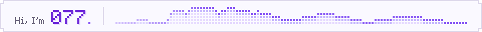

<picture>
  <source media="(prefers-color-scheme: dark)" srcset="assets/header-dark.svg">
  <source media="(prefers-color-scheme: light)" srcset="assets/header-light.svg">
  
</picture>

  <strong>Remote Sensing &nbsp;·&nbsp; Foundation Model Fine-Tuning</strong>

  I work on adapting foundation models for remote sensing, 
  with a focus on parameter-efficient fine-tuning and hyperspectral image analysis.

### 01 / Selected Work

| Project | Focus |
| :--- | :--- |
| [**Overtone**](https://github.com/LinYS77/Overtone) | Parameter-efficient adaptation for hyperspectral image analysis. *Preparing for release.* |
| [**pi-glance**](https://github.com/LinYS77/pi-glance) | A rounded editor and status line for pi. |
| [**pi-agentteam**](https://github.com/LinYS77/pi-agentteam) | Multi-agent team orchestration for pi, with visible tmux teammates and shared tasks. |

### 02 / Contribution Snake

<picture>
  <source media="(prefers-color-scheme: dark)" srcset="https://raw.githubusercontent.com/LinYS77/LinYS77/output/github-snake-dark.svg">
  <source media="(prefers-color-scheme: light)" srcset="https://raw.githubusercontent.com/LinYS77/LinYS77/output/github-snake.svg">
  
</picture>
